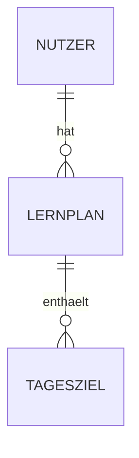

## Worum geht es?
Fast jede App speichert Daten: Nutzer, Beiträge, Termine … Ein **Datenmodell** beschreibt, welche **Tabellen** es gibt, welche **Felder** (Spalten) sie haben und welche **Beziehungen** zwischen ihnen bestehen.

Beispiel: Ein *Nutzer* (Name, E-Mail) hat viele *Lernpläne* (Titel, Prüfungsdatum), und jeder Lernplan hat viele *Tagesziele*.

## Warum ist das wichtig?
Das Datenmodell ist schwer nachträglich zu ändern – sobald echte Daten drin sind, wird jede Umstellung aufwendig. Wenn du es vorher festlegst, baut die KI eine passende Datenbank, statt bei jedem Feature neue Tabellen zu erfinden.

## So gehst du vor
1. Geh deine User Stories durch: Welche „Dinge“ kommen darin vor? Das sind deine Tabellen.
2. Notiere für jede Tabelle die Felder und ihre Art (Text, Zahl, Datum, Ja/Nein).
3. Beschreibe, wie die Tabellen zusammenhängen (eins-zu-viele, viele-zu-viele).
4. Speichere alles in `docs/datenmodell.md`.

Optional als Diagramm:

## Tipp: So fragst du Claude Code
> „Leite aus docs/user-stories.md ein Datenmodell ab. Erklär mir jede Tabelle in einfachen Worten und zeichne ein Mermaid-ER-Diagramm in docs/datenmodell.md.“
