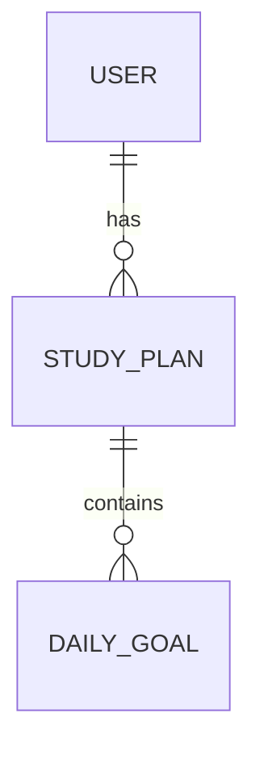

## What is this about?
Almost every app stores data: users, posts, appointments … A **data model** describes which **tables** exist, which **fields** (columns) they have and which **relationships** connect them.

Example: a *user* (name, email) has many *study plans* (title, exam date), and each study plan has many *daily goals*.

## Why does it matter?
A data model is hard to change later – once real data is stored, every change becomes costly. If you define it up front, the AI builds a fitting database instead of inventing new tables for every feature.

## How to do it
1. Go through your user stories: which “things” appear in them? Those are your tables.
2. Note the fields of each table and their type (text, number, date, yes/no).
3. Describe how the tables are connected (one-to-many, many-to-many).
4. Save everything in `docs/data-model.md`.

Optional as a diagram:

## Tip: How to ask Claude Code
> “Derive a data model from docs/user-stories.md. Explain each table in simple words and draw a Mermaid ER diagram in docs/data-model.md.”
