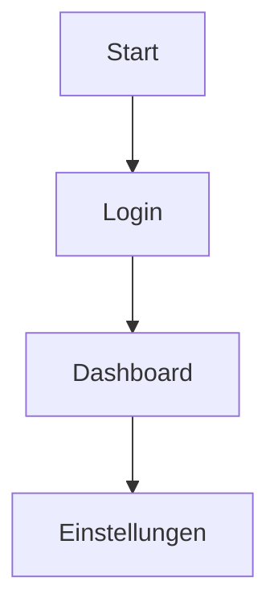

## Worum geht es?
Eine **Sitemap** zeigt alle Seiten deiner App und wie sie zusammenhängen. Das Fachwort dafür ist **Informationsarchitektur**: Welche Inhalte gibt es, wie sind sie gruppiert, und wie kommt man von A nach B?

## Warum ist das wichtig?
Ohne Struktur erfindet die KI bei jedem Prompt neue Seiten und Menüs. Mit einer Sitemap bleibt deine App übersichtlich – für dich, für die KI und für deine Nutzer.

## So gehst du vor
1. Lege `docs/sitemap.md` an.
2. Liste alle Seiten auf (z. B. Startseite, Login, Dashboard, Einstellungen).
3. Zeige durch Einrückung oder Pfeile, welche Seite von wo aus erreichbar ist.
4. Schreib zu jeder Seite einen Satz, wofür sie da ist.

Optional als Diagramm – GitHub stellt **Mermaid** automatisch grafisch dar:

## Tipp: So fragst du Claude Code
> „Leite aus docs/user-stories.md eine Sitemap ab, mit einem Satz pro Seite und einem Mermaid-Diagramm. Speichere sie in docs/sitemap.md.“
