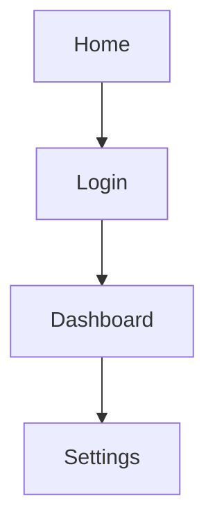

## What is this about?
A **sitemap** shows all pages of your app and how they are connected. The technical term is **information architecture**: which content exists, how is it grouped, and how do you get from A to B?

## Why does it matter?
Without a structure, the AI invents new pages and menus with every prompt. A sitemap keeps your app clear – for you, for the AI and for your users.

## How to do it
1. Create `docs/sitemap.md`.
2. List all pages (e.g. home, login, dashboard, settings).
3. Use indentation or arrows to show which page can be reached from where.
4. Write one sentence per page about its purpose.

Optional as a diagram – GitHub renders **Mermaid** automatically:

## Tip: How to ask Claude Code
> “Derive a sitemap from docs/user-stories.md, with one sentence per page and a Mermaid diagram. Save it to docs/sitemap.md.”
